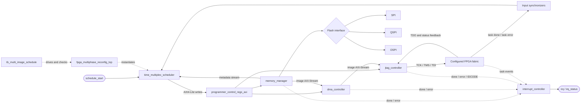

# FPGA Programmer — Integrated Multi-Image Schedule Simulation

This package contains the RTL files listed in the active Vivado design hierarchy and
the single integrated simulation testbench shown in the active simulation set.

## Contents
- `rtl/`: 13 RTL source files from the active Vivado design hierarchy.
- `tb/tb_multi_image_schedule.sv`: integrated three-image schedule testbench.
- `tb/models/`: behavioral JTAG target and multi-image QSPI NOR flash models.
- `sim/`: reserved for the saved waveform configuration and run evidence.
- `scripts/`: reserved for helper scripts.

## Architecture

The top-level scheduler reads the multi-image metadata from flash, configures the
control-register aperture over AXI4-Lite, and sequences each image through the
memory, DMA, and JTAG datapath. Target status and task events are synchronized
back into the scheduler; the interrupt controller aggregates completion and error
events.



The integrated simulation uses the QSPI path, a behavioral multi-image NOR flash,
and a behavioral JTAG target. SPI and OSPI remain available as memory-manager
interfaces for other configurations.

## Vivado setup
The original project used the simulation set `sim_multi_image_schedule`.
The testbench top is `tb_multi_image_schedule`.

Add the RTL sources to a design/source fileset and the three files under `tb/`
to the simulation fileset. Set `programmer_pkg.sv` as a package source and ensure
it is compiled before modules that import it. Use the SystemVerilog language mode.

## Focused RTL coverage run

`tb/tb_rtl_coverage.sv` is a separate XSim testbench for `programmer_pkg`,
`interrupt_controller`, and `time_multiplex_scheduler`. It checks the package
encodings and CRC helper, exercises interrupt masking/latching/clearing and
simultaneous events, and drives the scheduler through an AXI write error and
abort path. The simulation prints a functional coverage summary and stops on
the first failed check.

With the project open in Vivado, run this in the Tcl Console:

```tcl
source C:/path/to/ASIC_Project/scripts/run_rtl_coverage.tcl
```

The script creates/selects `sim_rtl_coverage` and sets `tb_rtl_coverage` as its
top. This is independent of `sim_multi_image_schedule`; use the existing
integrated testbench separately for end-to-end successful multi-image runs.
The printed counts are directed functional scenarios, not an XSim code
coverage percentage. They can guide additional tests for uncovered scheduler
branches and package types.

## Waveform note
A waveform configuration (`.wcfg`) is a layout file, not the waveform trace itself.
The supplied source archives did not include the active `.wcfg`, so it is not
bundled here. Save it from Vivado using **File → Save Waveform Configuration As**
and place it in `sim/`. Fresh traces are generated by rerunning the simulation.

## Scope
This is an RTL simulation with behavioral flash and target models. It does not
constitute validation of a physical FPGA bitstream or hardware.

## Add the package to an existing Vivado project

1. Extract this ZIP.
2. Open the intended `.xpr` project in Vivado.
3. In the Tcl Console, run (adjust the extracted directory path):
   `source /path/to/final_fpga_programmer_package/scripts/add_package_to_vivado.tcl`
4. The script adds the packaged RTL to `sources_1`, adds the integrated TB and behavioral models to `sim_multi_image_schedule`, sets `tb_multi_image_schedule` as simulation top, updates compile order, and launches simulation.

The script is designed to be rerun without adding the same package paths twice. It uses the package files in place; it does not copy them into the Vivado project directory.
