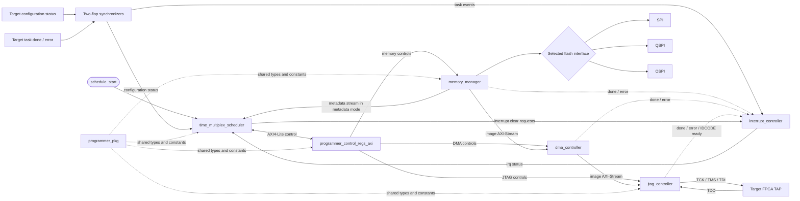
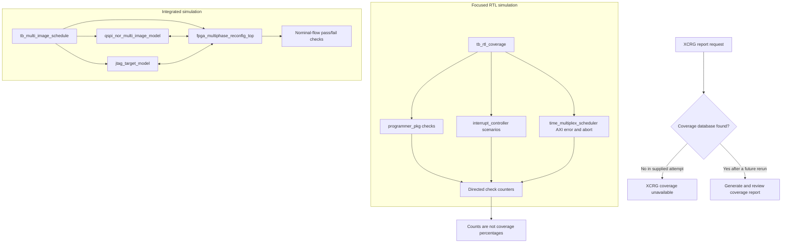

# FPGA Programmer: Multi-Image Reconfiguration RTL

This repository contains an RTL platform for sequencing configuration of multiple FPGA images stored in serial flash. The design coordinates metadata parsing, AXI4-Lite peripheral setup, AXI4-Stream image movement, JTAG programming, and target task-completion/error events.

## Architecture

The scheduler reads image metadata from the memory manager, configures the peripherals through the AXI4-Lite register aperture, and advances between images after target events. Metadata stream data goes directly to the scheduler; image data flows through the DMA bridge to the JTAG controller.



The top-level RTL currently selects the QSPI path. SPI and OSPI interfaces are also exposed by the memory manager. The target FPGA is external to this RTL: the top-level accepts configuration-status and task-event inputs and provides the JTAG pins.

## Repository layout

| Path | Purpose |
| --- | --- |
| `rtl/common/` | Shared package definitions and helper functions |
| `rtl/top/` | Top-level multi-phase reconfiguration design |
| `rtl/scheduler/` | Schedule sequencer and AXI4-Lite write master |
| `rtl/axi/` | AXI4-Lite programmer control register block |
| `rtl/memory/` | Memory manager and SPI, QSPI, OSPI, and flash-read RTL |
| `rtl/dma/` | AXI4-Stream DMA bridge |
| `rtl/jtag/` | JTAG TAP controller |
| `rtl/controller/` | Interrupt controller |
| `tb/tb_multi_image_schedule.sv` | Integrated three-image testbench source |
| `tb/tb_rtl_coverage.sv` | Focused package, interrupt, and scheduler testbench |
| `tb/models/` | Behavioral multi-image QSPI flash and JTAG target models |
| `scripts/` | Vivado Tcl setup and simulation scripts |

## Vivado simulation

### Integrated multi-image testbench

The integrated testbench top is `tb_multi_image_schedule`. Add the RTL under `rtl/` to the design source set, then add these simulation sources to a simulation set:

- `tb/tb_multi_image_schedule.sv`
- `tb/models/qspi_nor_multi_image_model.sv`
- `tb/models/jtag_target_model.sv`

Compile `rtl/common/programmer_pkg.sv` before modules that import it, use SystemVerilog mode, and set `tb_multi_image_schedule` as the simulation top. The testbench source contains checks for a nominal three-image QSPI-to-JTAG flow. Those checks are not evidence of a successful integrated run unless the corresponding XSim transcript is available.

With the intended Vivado project open, the helper script can add the package sources and launch the integrated simulation. Update the path for your checkout:

```tcl
source C:/path/to/ASIC_Project/scripts/add_package_to_vivado.tcl
```

### Focused RTL testbench

The focused testbench targets `programmer_pkg`, `interrupt_controller`, and `time_multiplex_scheduler`. It checks package constants, enum values and CRC helper behavior; exercises interrupt capture, masking, sticky status and clearing; and drives a scheduler AXI write-error/abort scenario.

With the project open in Vivado, run:

```tcl
source C:/path/to/ASIC_Project/scripts/run_rtl_coverage.tcl
```

The script creates or reuses `sim_rtl_coverage`, adds the focused testbench and its required RTL, sets `tb_rtl_coverage` as simulation top, updates compile order, and launches XSim. This testbench is separate from the integrated simulation set.

## Focused run results and coverage status

The supplied Vivado XSim transcript reported:

| Target | Reported checks / scenarios |
| --- | ---: |
| `programmer_pkg` | 94 checked cases |
| `interrupt_controller` | 12 checked scenarios |
| `time_multiplex_scheduler` | 3 checked scenarios |
| Scoreboard | 29 checks |
| Simulation | Reached `$finish` at 390 ns without a testbench failure |

These are directed testbench check and scenario counts. They are **not** code-coverage or functional-coverage percentages. Although the current focused testbench contains SystemVerilog covergroups, the supplied successful transcript predates their addition. The subsequent `xcrg` attempt reported that no functional coverage database was found, so no XCRG percentage, bin total, or cross-coverage result is available. Rerun the simulation with recognized covergroups or enabled code coverage, confirm an XSim coverage database is created, and then run XCRG before reporting percentages.

The integrated testbench also defines executable nominal-flow checks. Treat those as testbench expectations until a successful integrated XSim run log is archived.

## Verification flow

The two benches have different scopes. The focused bench checks selected package, interrupt, and scheduler behavior. The integrated bench connects the top-level RTL to behavioral flash and JTAG target models.



## Waveforms and hardware scope

A `.wcfg` file stores a waveform viewer layout; it is not the waveform trace. Save a configuration from Vivado with **File → Save Waveform Configuration As** if you want to preserve a signal layout. Simulation traces are generated by rerunning XSim.

This package documents RTL simulation with behavioral flash and JTAG target models. It does not establish physical-board operation, bitstream correctness on a target device, synthesis utilization, or timing closure.
